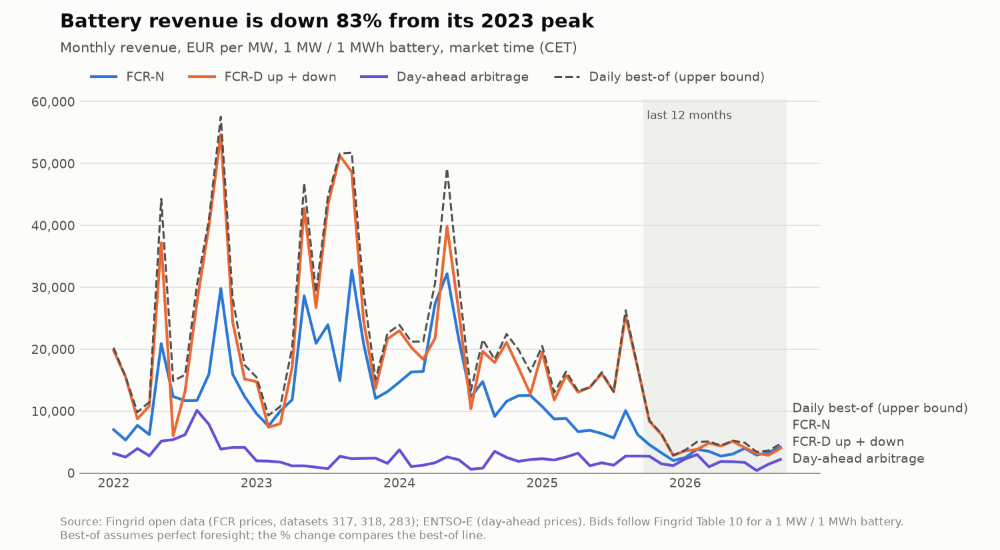

# A battery in Finland earned at most 57,266 EUR/MW from frequency reserves in the last 12 months, 84% below the 2023 peak

**Question:** where does a 1 MW / 1 MWh battery in Finland earn its money, and how has that changed?

**Answer (October 2025 – September 2026):** in **FCR-D**. Offering FCR-D up and down together earned **53,215 EUR/MW/year**, against **39,831** for FCR-N. Picking the better product every day with perfect hindsight raises that to an upper bound of **57,266**. Since the 2023 peak of **346,660**, that upper bound has fallen by 84%, as batteries have filled Finland's reserve markets.

## Key findings

- **FCR-D is the main revenue stream for a 1-hour battery.** It won 280 of 365 days against FCR-N's 85.
- **Fingrid's battery rules decide the ranking.** A 1 MWh battery may bid only **0.5 MW** into FCR-N but **0.833 MW** into each FCR-D direction. If the full 1 MW could be bid, FCR-N would lead with 79,663 against FCR-D's 63,858. A 2-hour battery can bid more FCR-N, and the ranking flips back. To check, set `energy_mwh = 2.0` in [params.toml](params.toml) and re-run.
- **The market is saturating fast.** The upper bound, annualised by calendar year:

  | Year | FCR-N | FCR-D up + down | Daily best-of |
  |---|---|---|---|
  | 2022 | 156,943 | 273,032 | 304,144 |
  | 2023 | 206,299 | 319,876 | 346,660 |
  | 2024 | 200,676 | 247,274 | 287,734 |
  | 2025 | 80,071 | 163,188 | 167,374 |
  | 2026 (Jan–Sep) | 40,080 | 47,882 | 53,152 |

  EUR per MW per year, annualised. 2026 covers January to September only; for a like-for-like comparison of the same months in every year, see `ytd_like_for_like` in [summary.json](data/output/summary.json).
- **The decline is still running, and it hits FCR-D hardest.** From the first quarter of the headline year (Oct–Dec 2025) to the last (Jul–Sep 2026), FCR-D revenue fell 42.5% while FCR-N rose 5.6%. By August, FCR-N was winning most days. The best month was October 2025 (8,344 EUR/MW, best-of) and the worst was December 2025 (2,827).
- **FCR-D up is an evening product.** Its price peaks at 18:00 CET, 3.4× its 03:00 low. FCR-N and FCR-D down stay almost flat through the day.



More charts: [price distribution per product](data/output/charts/price_distribution.png) and [average price by hour of day](data/output/charts/daily_price_profile.png). All numbers come from [summary.json](data/output/summary.json) and [monthly_revenue.csv](data/output/monthly_revenue.csv). A test fails if this README and summary.json disagree.

## Method in plain words

1. **Download** hourly FCR prices from Fingrid's open data API (datasets 317, 318 and 283), January 2022 to September 2026.
2. **Check** the data before using it: explicit UTC timestamps, no duplicate hours, one resolution, every day complete, no gaps. Price spikes are flagged but never removed. Every check passed. The only flags are the expected spikes in the top 0.1% of hours, listed in `data_quality` in summary.json.
3. **Tidy** the data into one table of hourly prices in CET, the time zone Fingrid's market days use.
4. **Calculate revenue** for each strategy, every hour: price × MW offered. The MW offered is the largest bid Fingrid's rules allow for this battery (see [How a battery makes money](#how-a-battery-makes-money)).
5. **Summarise** by day, month and year, and write the CSV, the JSON and the charts.

One command rebuilds everything from an empty `data/` folder. All inputs (periods, battery size, efficiency, availability) are in [params.toml](params.toml), each with the reason for its value.

## Limits

These numbers show where the money **is** in the market, not what a real project would earn. A real battery earns less, because:

- **No perfect foresight.** Bids are placed the day before prices are known, so a real operator won't always pick the better product. The daily best-of is an upper bound.
- **100% availability.** Maintenance and outages are not modelled. Set `availability` in params.toml for a scenario.
- **No bidding strategy.** The model assumes every bid is accepted at the clearing price. A real bid can be rejected, or set the price itself.
- **No degradation, fees or tariffs.** Battery wear, grid fees and market fees are not deducted.
- **Capacity payments only.** Payments for energy actually delivered during activations are not included.
- **Hourly market only.** Fingrid also buys FCR through a yearly market, which is not modelled.
- **Today's rules applied to earlier years.** The bid limits come from the May 2025 requirements and are used for 2022–2025 as well, so the years compare like for like. The rules were different then.
- **No energy trading yet.** Day-ahead arbitrage is coded and tested, but waits for ENTSO-E price data.

## What this means for new Nordic projects

*Author's section, to be written.*

## How a battery makes money

A grid battery has two ways to earn in Finland: standing ready for the grid (frequency reserves) and trading energy (arbitrage).

### Standing ready for the grid (frequency reserves)

The grid has to stay at 50 Hz. When more power is used than produced, frequency falls. When more is produced than used, it rises. Fingrid, the Finnish grid operator, buys **Frequency Containment Reserves (FCR)**: capacity that reacts automatically within seconds to push the frequency back.

Fingrid pays for **being available**, not for energy delivered. The owner promises "for this hour, X MW of my battery will respond to frequency" and is paid the hourly price for that promise, whether or not the grid calls on it.

| Product | What the battery does | When it activates |
|---|---|---|
| **FCR-N** (normal operation) | Charges or discharges a little, continuously | Whenever frequency leaves 50.0 Hz; full output at 49.9 or 50.1 Hz |
| **FCR-D up** (disturbance) | Discharges | Below 49.9 Hz; full output at 49.5 Hz, e.g. when a large plant trips |
| **FCR-D down** (disturbance) | Charges | Above 50.1 Hz; full output at 50.5 Hz, e.g. when a large load drops out |

```
revenue (EUR) = price (EUR/MW/h) × MW offered × 1 hour
```

**Fingrid's rules limit how much a battery can offer.** For every MW offered, a battery must keep spare power and spare stored energy, so it can react and still manage its charge level ([Nordic FCR Technical Requirements](https://www.fingrid.fi/globalassets/dokumentit/fi/sahkomarkkinat/reservit/technical-requirements-for-frequency-containment-reserve-provision-in-the-nordic-synchronous-area_14.5.2025.pdf), Table 10, valid in Finland from 14 May 2025):

- **FCR-N:** 1 hour of energy in *each* direction per MW offered. A 1 MWh battery at half charge can therefore back only **0.5 MW**.
- **FCR-D up + down at the same time:** this is allowed ([Batteries in the Nordic reserve markets](https://www.fingrid.fi/globalassets/dokumentit/fi/sahkomarkkinat/reservit/batteries-in-the-nordic-reserve-markets-april-2025.pdf), p. 7). Each direction needs its own MW plus 20% in the other direction, so 1.2 × 0.833 = 1 MW of power: **0.833 MW** each way.
- **The same MW can't be sold in two markets at once,** so the strategies below are alternatives.

### Trading energy (day-ahead arbitrage)

The battery charges when electricity is cheap and discharges when it is expensive, once per day, with the charge hour before the discharge hour. With 88% round-trip efficiency:

```
revenue (EUR) = sell price × 1 MWh − buy price × (1 MWh ÷ 0.88)
```

*Example:* buy at 20 EUR/MWh and sell at 120 EUR/MWh gives 120 − 20 ÷ 0.88 = 97.27 EUR for the day. If the spread is too small to cover the losses, the battery doesn't trade.

### Strategies compared

1. **FCR-N only:** 0.5 MW of FCR-N every hour.
2. **FCR-D up + down:** 0.833 MW of each, every hour.
3. **Day-ahead arbitrage:** one cycle per day (not yet run; needs ENTSO-E data).
4. **Daily best-of:** the best of the above for each day. This is an upper bound, because it assumes perfect foresight.

### Market context

Independent sources describe the same shift. [Olana](https://olana.fi/blog-posts/the-merchant-bess-business-case) (May 2026) says reserve revenues have peaked and energy-market revenues are rising. [Solarplaza](https://www.solarplaza.com/resource/13522/article-finlands-bess-market-beyond-the-gold-rush-2026/) (July 2026) reports about 1.5 GW of batteries built in Finland in a couple of years, and calls the reserve market "quite saturated". [RaboResearch](https://www.rabobank.com/knowledge/d011535313-backup-power-for-europe-part-8-ranking-bess-market-attractivity-in-the-nordics) (July 2026) sees value moving from FCR and FFR to the deeper aFRR and mFRR markets, and reports Finnish day-ahead spreads averaging above 90 EUR/MWh.

## How to run

Requires Windows, macOS or Linux, [uv](https://docs.astral.sh/uv/) and a free [Fingrid API key](https://developer-data.fingrid.fi/) (Products → Open Data starter → Subscribe, then Profile → Primary key).

```bash
uv venv --python 3.12 .venv
uv pip install -e ".[dev]"
cp .env.example .env
```

Put your key after `FINGRID_API_KEY=` in `.env`, then:

```bash
.venv/Scripts/python -m nordic_bess.pipeline
```

On macOS and Linux, use `.venv/bin/python`. The first run downloads about 177 monthly files at Fingrid's limit of one request per 2 seconds, which takes about 8 minutes. Later runs reuse the files on disk and take seconds. Options:

- `--config my_scenario.toml` for different inputs
- `--start` and `--end` (YYYY-MM-DD) for a different headline period
- `--refresh` to download again

Checks: `pytest`, `ruff check .`, `ruff format --check .`, `mypy src`.

Data: Fingrid open data, [CC BY 4.0](https://creativecommons.org/licenses/by/4.0/).
